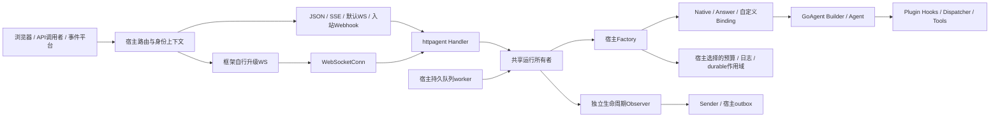
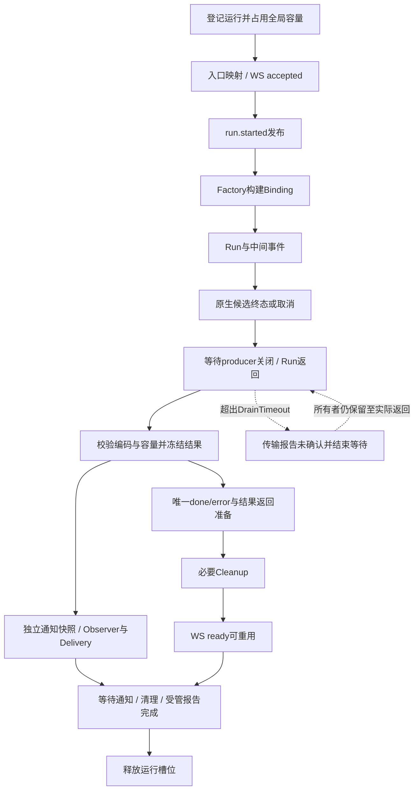
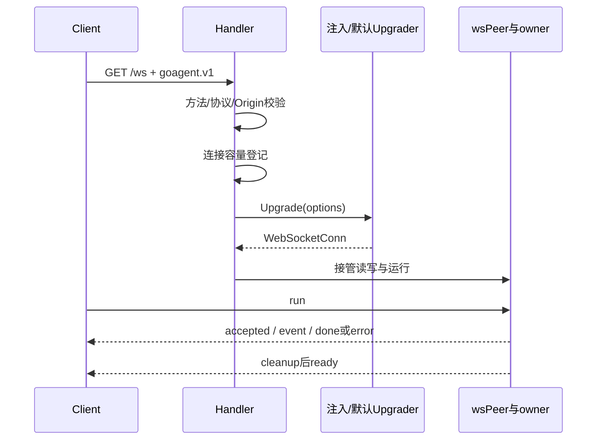
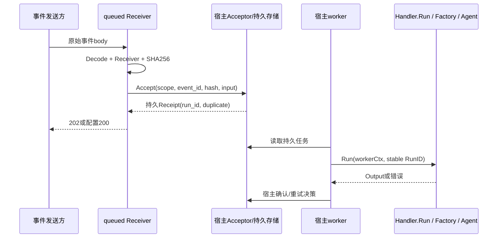

# HTTP Agent 设计

本文件描述已实现的cfb3e85代码契约，供接入者和维护者使用。完整装配见 [使用指南](USER_GUIDE.md)，结构体/默认值/协议见 [API参考](API_REFERENCE.md)。早期方案与验收记录留在GoAgent仓库，不作为未实现功能的承诺。

## 1. 定位与模块边界

httpagent将宿主已装配的执行能力接入网络，保持GoAgent作为执行内核。业务工具与Hook属于Plugin/Dispatcher，Agent/workflow及持久作用域由Factory选择；此包不再创建另一套Agent引擎、图引擎、任务队列或完整聊天平台。

- 主库不依赖httpagent；扩展是独立Go模块，页面和业务案例在goagent-examples。
- 默认WebSocket帧库保留Gorilla，公开协议接口不暴露其类型；主库中Gemini SDK的Gorilla间接依赖不因接口化删除。
- HTTP入口与worker使用相同Factory/Binding，预算、日志和原生Hook是否启用取决于宿主配置，并非适配器自动持久化。
- 默认按运行隔离会话；同业务SessionID跨实例并发仍由宿主锁/租约协调。

## 2. 为什么用Binding而不是直接选执行方法

[binding.go](../binding.go)定义显式执行绑定：Run函数、Streaming能力及说明性Mode。选择Native时，各传输均消费同一ExecuteStream事件循环，因此同步HTTP也能保留原生工具调用。

Native截获原始done/error候选，继续读取到事件流关闭；Handler据最终结果和context状态只冻结一次对外终态。中途传输失败会取消原生producer并继续等其关闭，避免工具仍在执行时提前清理。未知EOF、缺结果、重复终态或终态后事件被视为失败，不自动重试另一种入口。

Answer是显式的普通同步回答绑定，Streaming=false；/stream在调用Run前返回501。Agent有ExecuteStream方法不代表当前模型支持原生工具流，Factory须检查真实模型客户端能力。这样既不伪造流式，也不在失败后重新执行可能有副作用的业务。

自定义Binding是宿主扩展点；需遵守与Native同样的终态、取消和资源责任。接口不能强制阻止宿主内部创建脱离context的goroutine。

## 3. 共享运行所有者

[handler.go](../handler.go)管理准入与停服，[run.go](../run.go)管理owner。下图是内部生命周期示意，不是可持久恢复的状态枚举。

关键约束：

1. 先登记再构造，MaxActiveRuns覆盖Factory、queued接纳、执行及延迟工作。迟到Factory返回的Cleanup仍可正确接管。
2. 客户端取消、运行期限、生产者候选终态都可能启动退出等待。DrainTimeout只表示“当前仍未确认退出”，不能伪造已完成业务终态。
3. Native实际返回后，校验结果JSON、事件大小及WS完整外层包装；无法编码/超限转换为错误，不重跑工具。
4. 结果冻结前的取消可能改变最终结果；冻结后的取消返回already_finished，不修改已冻结结果。
5. 冻结的通知与返回Output独立快照，Observer或worker修改返回值不能污染另一目标的通知。
6. Cleanup和终态通知独立推进，但都归当前owner跟踪。终态发送、资源退出、通知尝试完成是不同时间点。

结果对外准备后，JSON/inline/worker在通知context预算内等待尝试；SSE/WS终态可先发送。WS ready等必要Cleanup，运行槽位还要等通知及相关Report回调退出，不能把ready理解为全局槽位已回收。

Observer/Delivery/Report的错误或panic独立报告，不重新执行业务。发布时Observer在Delivery前同步调用；特别是started发布位于Factory之前，忽略context的Observer可能阻塞构建或耗尽投递预算。预算是合作式context，不会强停任意Go代码。

## 4. JSON与SSE的传输边界

[transport.go](../transport.go)使用ResponseController管理写期限，SSE额外要求Flush能力。HTTP中间件必须保留这些能力或提供Unwrap；缺能力时先501拒绝，再避免进入Factory/接纳。

- JSON只返回稳定Output投影，不序列化AgentState。
- SSE中间事件先编码，再经有确认的sink写入。写失败取消运行，所有者继续负责实际退出。
- 能力检查尚未成功前，不为心跳提交HTTP200；检查完成后，即使尚无首个业务事件也可发送注释心跳。
- 首次提交前的错误使用HTTP JSON状态；之后错误通过SSE终态表达，不能再次改变HTTP状态。
- 原生终态后未退出时，JSON若尚可应答则504 execution_unconfirmed；已提交SSE/WS关闭而不发伪业务终态。断线客户端需把无终态EOF标为未确认。

未提供POST自动重试、SSE恢复游标、跨连接取消和后台继续聊天语义。运行与外部工具副作用是不同边界，网络失败不能证明业务没有发生。

## 5. WebSocket接口与两种所有权入口

| 部件 | 职责 |
| --- | --- |
| WebSocketUpgrader | 将标准HTTP请求升级，协商options子协议与期限 |
| WebSocketConn | 完整文本读写、控制帧、读限制、期限、Pong回调、Close |
| wsPeer | 单reader/writer、输出队列、活动运行与ready顺序 |
| Handler.ServeWebSocket | 已升级连接的生命周期接管 |
| 默认Gorilla包装 | 仅具体帧实现与SDK适配 |

源码分离为 [接口](../websocket_transport.go)、[协议运行](../websocket.go)、[默认适配器](../websocket_gorilla.go)。

### Handler管理标准HTTP升级

升级中也占连接槽位，Shutdown会纳管迟到连接；不能直到Upgrade成功后才登记。标准Origin策略（HTTP/HTTPS且Host与请求Host匹配）与goagent.v1检查位于所有适配器共用路径，自定义Upgrader不能因替换帧库而跳过这些检查。

### 框架已经完成升级

宿主先执行自己的握手策略及认证，再调用ServeWebSocket。此时HTTP握手已经完成，Handler只负责连接接纳；容量或停服拒绝以返回错误并关闭连接表达。宿主负责尚未交付的握手和框架ctx有效期。

连接必须独占交给Handler，不能在框架处理器另开reader/writer。适配器须让Close安全解除读写阻塞，不能用无操作deadline方法占位；依赖context的框架需要将读写期限映射到操作context。Ping发送与Pong响应不得同步互等。运行层也检查完整输入长度，但帧库仍须提前限制分配。

每连接同一时间一个运行，read循环处理run/cancel，writer串行发送消息及Ping。队列同时限制项数和字节数；写完成确认、写期限、心跳和关闭共同约束慢消费者。ready按单writer顺序在必要Cleanup之后发送。seq只用于本次运行排序，不能作为恢复协议。

## 6. 双向Webhook

### 接收与持久接纳分离

inline直接使用owner运行并等完整结果，适合自有同步调用；queued只在Decode/Accept完成并返回有效收据后ACK，接收HTTP结束不负责启动Agent。接纳阶段也占运行容量，未结束的接纳不能在停服时假装释放。

Acceptor至少按tenant/source/receiver/event_id去重，持久保存payload hash与输入；相同键同body返回同RunID，不同body冲突409。接纳期限或断线后可能已入库但应答未达，调用方需保持稳定身份。Handler不会把进程内goroutine伪装成持久接纳。

Handler.Run共用执行管道但不缓存已完成结果，也不自动启动队列消费者。同一RunID再次提交可能再执行；worker和工具应组合durable恢复、业务幂等或宿主任务状态协调。生产队列、租约、退避、死信和平台签名/challenge适配是宿主职责。测试用磁盘Acceptor只证明接纳契约。

### 出站观察与投递

生命周期RunEvent在发布前成为独立JSON快照，同次通知的所有目标共用event_id；Observer与Delivery各获副本。started与终态各有一次DeliveryBudget，Observer先执行，Sender依次访问目标并共享剩余context。默认只选择终态，显式Events可订阅started。

Sender只做一次应用层尝试、不跟随重定向、2xx成功；失败交给Report，不改变已经冻结的业务结果。没有事务性“业务完成+可靠发信”保证，进程崩溃可能丢通知；需要可靠投递时注入宿主持久outbox，而不是让Sender重执行业务。

## 7. 停服与故障责任

顺序固定为BeginShutdown → 等HTTP Shutdown与Handler.Shutdown → 成功后关闭共享Host/存储。单纯先等HTTP Shutdown既不会取消活动请求，也不管理已升级WS。

| 故障 | 客户端结果 | 仍保留的责任 |
| --- | --- | --- |
| Factory忽略取消或producer未关闭 | 退出等待超时后未确认/断流 | owner、容量、迟到Cleanup |
| 正常结果无法编码或过大 | 单一错误终态，必要时关闭WS | 不重新执行工具，继续Cleanup |
| 慢消费者/写失败 | 连接关闭、运行取消 | producer真实退出与清理 |
| Cleanup忽略期限 | 可能已返回业务结果，WS ready仍等清理 | 容量和Shutdown等待 |
| 通知/Observer错误 | 业务结果独立，诊断进入Report | 当前通知尝试与清理仍受管 |
| queued接纳期限 | 503未确认 | 接纳迟到返回前保留owner |
| 自定义升级器迟到成功 | 拒绝并关闭迟到连接 | 升级返回前保持连接登记 |

超时是可诊断的等待结果，不是强制终止或回滚。恢复时保留业务身份并判断副作用；不要仅凭HTTP失败换ID重试。

## 8. 验证与变更维护

[binding_test.go](../binding_test.go)、[handler_test.go](../handler_test.go)、[webhook_test.go](../webhook_test.go)、[websocket_test.go](../websocket_test.go)、[websocket_transport_test.go](../websocket_transport_test.go)、[integration_test.go](../integration_test.go)分别覆盖绑定、资源责任、接纳/通知、真实WS、替换接口及五入口治理组合。

集成测试使用真实Builder、Plugin、Dispatcher、持久预算和会话FileStore；模型HTTP响应由脚本控制。案例还验证外部宿主包装、真实浏览器和取消。协议改动需同步API参考、客户端解析器及握手/终态/停服回归；文档代码验证见 [文档校验说明](VERIFICATION.md)。
